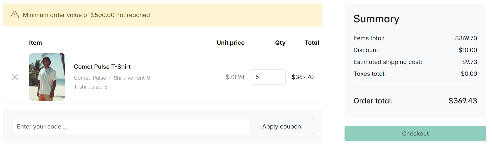

# Sylius Minimum Order Value Plugin

The **Minimum Order Value** plugin for **Sylius** allows admin users to define a minimum
order value per channel. Orders whose items total (the value of the products in the cart,
excluding shipping and order-level discounts) is below that value cannot be completed.



## Installation

1. Install the package via Composer:

```bash
composer require bitexpert/sylius-minimum-order-value
```

2. Enable the plugin in your `config/bundles.php`:

```php
return [
    // ...
    BitExpert\SyliusMinimumOrderValuePlugin\BitExpertSyliusMinimumOrderValuePlugin::class => ['all' => true],
];
```

3. Import plugin configuration
```yaml
# config/packages/bitexpert_sylius_minimum_order_value.yaml
imports:
  - { resource: "@BitExpertSyliusMinimumOrderValuePlugin/config/config.yaml" }
```

4. Modify `Channel` entity

Let `App\Entity\Channel\Channel` entity implement the `BitExpert\SyliusMinimumOrderValuePlugin\Entity\MinimumOrderValueAwareInterface` and
add the `BitExpert\SyliusMinimumOrderValuePlugin\Entity\MinimumOrderValueTrait` trait:
```php
<?php

declare(strict_types=1);

namespace App\Entity\Channel;

use BitExpert\SyliusMinimumOrderValuePlugin\Entity\MinimumOrderValueAwareInterface;
use BitExpert\SyliusMinimumOrderValuePlugin\Entity\MinimumOrderValueTrait;
use Sylius\Component\Core\Model\Channel as BaseChannel;

class Channel extends BaseChannel implements MinimumOrderValueAwareInterface
{
    use MinimumOrderValueTrait;
}
```

5. Update your database:

```bash
./bin/console doctrine:migrations:diff
./bin/console doctrine:migrations:migrate
```

## Customizing the calculation

Every place that evaluates the minimum order value (workflow guard, checkout form validation)
depends on `BitExpert\SyliusMinimumOrderValuePlugin\Checker\MinimumOrderValueCheckerInterface`.
A service alias points the interface at the default `MinimumOrderValueChecker`, so you can swap
in your own implementation without touching the plugin — useful when the default comparison
(e.g. `order.itemsTotal < minimum * 100`) does not match your requirements:

```php
<?php

declare(strict_types=1);

namespace App\Checker;

use BitExpert\SyliusMinimumOrderValuePlugin\Checker\MinimumOrderValueCheckerInterface;
use Sylius\Component\Core\Model\OrderInterface;

final class CustomMinimumOrderValueChecker implements MinimumOrderValueCheckerInterface
{
    public function isBelowMinimumOrderValue(OrderInterface $order): bool
    {
        // Your comparison logic, e.g. per product category or excluding promotions.
    }
}
```

```yaml
# config/services.yaml
services:
    BitExpert\SyliusMinimumOrderValuePlugin\Checker\MinimumOrderValueCheckerInterface:
        class: App\Checker\CustomMinimumOrderValueChecker
```

Note: 
the custom checker decides whether the checkout form rejects an order and whether the workflow guard blocks it. 
The amount shown in the form error message (and the cart/checkout button disabling in Twig) is read from the 
channel's `minimumOrderValue` directly — when a custom checker rejects an order without a channel value, the form 
shows a generic error message without an amount.

## Testing

```bash
vendor/bin/phpunit
```

## License

The **Minimum Order Value** plugin for **Sylius** is released under the MIT license.
